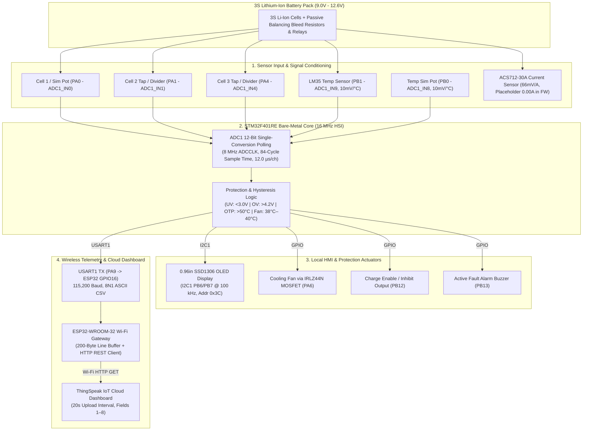

# System Architecture

## 1. System Overview & Block Diagram

The **Intelligent Battery Management System (BMS)** for a 3-cell series (3S) Lithium-Ion battery pack is structured into three functional layers:
1. **Sensing & Actuation Layer:** Analog voltage-divider taps/potentiometers, an LM35 precision temperature sensor, an ACS712-30A current sensor interface, passive resistive cell-balancing relays, an IRLZ44N cooling fan MOSFET, a charge-control MOSFET/relay, and a fault alarm buzzer.
2. **Embedded Control Layer (STM32F401RE):** Bare-metal C firmware using direct CMSIS register access (no HAL) operating on the $16\text{ MHz}$ High-Speed Internal (HSI) clock. Executes sequential ADC polling, threshold fault detection, thermal fan hysteresis control, local SSD1306 OLED updates, and UART telemetry framing.
3. **Wireless Monitoring Layer (ESP32 + ThingSpeak):** An ESP32-WROOM-32 gateway ingests the ASCII telemetry stream over hardware UART (`Serial2` on `GPIO16`) and uploads field updates over 2.4 GHz Wi-Fi to the ThingSpeak cloud platform.



---

## 2. End-to-End Data Path Breakdown

### Path 1: Sensor Input and Signal Conditioning
* **Cell 1 (`PA0` / `ADC1_IN0`):** Connected to a $10\text{k}\Omega$ potentiometer ($0\text{ V} \text{ to } 3.3\text{ V}$) to simulate full cell voltage sweeps during bench testing.
* **Cell 2 (`PA1` / `ADC1_IN1`) & Cell 3 (`PA4` / `ADC1_IN4`):** Acquire cell node voltages conditioned via resistive voltage dividers to keep inputs strictly within the $0\text{ V} \text{ to } 3.3\text{ V}$ STM32 ADC safe operating range.
* **LM35 Temperature Sensor (`PB1` / `ADC1_IN9`):** Mounted on the battery pack casing; outputs a linear voltage of $10\text{ mV}/^\circ\text{C}$ ($0.25\text{ V}$ at $25^\circ\text{C}$, $0.50\text{ V}$ at $50^\circ\text{C}$).
* **Simulated Temperature (`PB0` / `ADC1_IN8`):** Second $10\text{k}\Omega$ potentiometer ($0\text{ V} \text{ to } 3.3\text{ V}$) emulating an LM35 output for deterministic thermal testing without an external heat source.
* **Current Sensing (`ACS712-30A`):** Hall-effect sensor ($66\text{ mV/A}$ sensitivity, $V_{\text{CC}}/2 = 2.5\text{ V}$ quiescent output) wired in series with the high-side rail; reported as `0.00` placeholder in the current firmware iteration.
* **Passive Cell Balancing:** Bleed resistors switched via relay contacts across individual cells to dissipate excess energy from higher-voltage cells.

---

### Path 2: STM32 ADC Acquisition and Scaling
* **Clock Tree:** Runs on the $16\text{ MHz}$ HSI oscillator with no PLL (`PCLK2 = 16 MHz` for `ADC1` and `USART1`; `PCLK1 = 8 MHz` for `I2C1`).
* **ADC1 Configuration:** 12-bit resolution ($0\text{–}4095$, right-aligned) in single-conversion polling mode (`ADC_Read()`).
  * `ADCCLK` = $\text{PCLK2} / 2 = 8\text{ MHz}$.
  * Sample time = $84\text{ cycles}$ (`SMPR2` code `4`) + $12\text{ conversion cycles}$ = **$12.0\text{ }\mu\text{s}$ per channel** ($60\text{ }\mu\text{s}$ total for 5 sequential channels).
* **Conversion & Scaling Equations:**
  * **Pin Voltage:**
    $$V_{\text{pin}} = \frac{\text{ADC}_{\text{raw}}}{4095} \times 3.3\text{ [V]}$$
  * **Simulated Cell 1 Voltage:**
    $$V_{\text{cell1}} = \left(\frac{V_{\text{ADC0}}}{3.3}\right) \times 4.2\text{ [V]}$$
  * **Cell 2 & Cell 3 Voltages:** Evaluated directly from scaled node readings `adc_voltage_cell2` (`PA1`) and `adc_voltage_cell3` (`PA4`).
  * **Temperatures:**
    $$T_{\text{actual}} = \frac{V_{\text{LM35}}}{0.010}\text{ [}^\circ\text{C]}, \qquad T_{\text{simulated}} = \frac{V_{\text{pot}}}{0.010}\text{ [}^\circ\text{C]}$$

---

### Path 3: Filtering and Validation
* **Thermal Hysteresis Deadband:** The cooling fan controller implements a $2^\circ\text{C}$ hysteresis band (`FAN_ON_TEMP = 40.0f`, `FAN_OFF_TEMP = 38.0f`) to eliminate rapid MOSFET switching oscillation near the thermal threshold.
* **I2C Bus Timeout Protection:** `I2C_Write()` incorporates a `100,000`-iteration timeout counter and NACK flag recovery (`I2C1->SR1 &= ~(1U << 10)` followed by `STOP`) so an OLED disconnection or bus glitch cannot stall the main BMS protection loop.
* **Digital Sample Filtering:** Not implemented in the current firmware version; raw single-conversion ADC readings directly feed threshold checks on each loop cycle.

---

### Path 4: Threshold Checks, Control Outputs & Fault Behavior
Every main-loop iteration (~$50\text{ ms}$ loop delay via `800,000` NOP cycles + I2C OLED refresh) evaluates protection rules and updates actuators:

| Condition / Subsystem | Threshold / Rule | Pin & Peripheral | Hardware Action & Fault-State Behaviour |
| :--- | :--- | :--- | :--- |
| **Under-Voltage Protection (UVP)** | Any cell ($C_1, C_2, C_3$) $< 3.0\text{ V}$ | `PB13` (Buzzer), `PB12` (Charge) | Sets `undervoltage_fault = 1`, `fault = 1`; asserts buzzer HIGH; drives `PB12` LOW to inhibit charging; displays `FAULT: UNDER VOLT`. |
| **Over-Voltage Protection (OVP)** | Any cell ($C_1, C_2, C_3$) $> 4.2\text{ V}$ | `PB13` (Buzzer), `PB12` (Charge) | Sets `overvoltage_fault = 1`, `fault = 1`; asserts buzzer HIGH; drives `PB12` LOW to inhibit charging; displays `FAULT: OVER VOLT`. |
| **Over-Temperature Protection (OTP)** | $T_{\text{actual}}$ (LM35) $> 50.0^\circ\text{C}$ | `PB13` (Buzzer), `PB12` (Charge) | Sets `overtemperature_fault = 1`, `fault = 1`; asserts buzzer HIGH; drives `PB12` LOW to inhibit charging; displays `FAULT: OVER TEMP`. |
| **Normal Charge Window** | All cells $< 4.2\text{ V}$, $T_{\text{actual}} < 50.0^\circ\text{C}$, and `fault == 0` | `PB12` (`GPIO_Output`) | Drives `PB12` HIGH to enable the charger relay/MOSFET; buzzer remains OFF; displays `FAULT: NORMAL`. |
| **Thermal Fan Control** | $T_{\text{simulated}} \ge 40.0^\circ\text{C}$ (ON)<br>$T_{\text{simulated}} \le 38.0^\circ\text{C}$ (OFF) | `PA6` (`GPIO_Output` $\rightarrow$ IRLZ44N) | Latches `fan_status = 1` at $\ge 40^\circ\text{C}$ and clears at $\le 38^\circ\text{C}$; maintains prior state inside $38^\circ\text{C}–40^\circ\text{C}$. |
| **Local OLED Display** | Updated once per main-loop iteration | `PB6` (SCL), `PB7` (SDA) @ $100\text{ kHz}$ | Clears all 8 pages ($128 \times 64$ px, addr `0x3C`) and renders 7 rows (`BMS MONITOR`, `C1/C2`, `C3`, `LM35`, `SIM T`, `FAULT`, `FAN`) using a $5 \times 7$ bitmap font. |

* **Autonomous Recovery:** Fault flags are evaluated combinatorially on every cycle; once all cell voltages and temperatures return within safe limits, the buzzer turns off and `PB12` automatically re-enables charging.

---

### Path 5: UART Frame Sent to ESP32
* **Peripheral Configuration:** `USART1` configured in asynchronous transmit-only mode on **`PA9` (`AF7`)** wired to ESP32 **`GPIO16` (`Serial2 RX`)**.
* **Baud Rate & Framing:** **115,200 bps, 8N1**. With `PCLK2 = 16 MHz`, `USART1->BRR = 0x8B` ($139_{10}$), yielding $115,108\text{ bps}$ ($0.08\%$ error).
* **ASCII Telemetry Frame Format:**
  ```text
  C1:<v1>,C2:<v2>,C3:<v3>,T1:<t1>,T2:<t2>,I:<i>,Fault:<f>,Fan:<fan>\r\n
  ```
  * **Example Frame:** `C1:3.69,C2:3.84,C3:3.91,T1:28.7,T2:34.60,I:0.00,Fault:0,Fan:0\r\n`
  * **Transmission Rate:** Streamed once per STM32 main loop (~$50\text{ ms}$ NOP delay plus I2C display refresh overhead).

---

### Path 6: ESP32 Network Upload and Dashboard Visualization
* **UART Ingestion (`Serial2`):** The ESP32 buffers incoming bytes from `GPIO16` at $115,200\text{ baud}$ into a **200-byte character buffer** until a newline (`\n`) terminator is detected.
* **Cloud Upload Rate & Protocol:**
  * Connects to a $2.4\text{ GHz}$ 802.11 Wi-Fi network (`WiFi.begin()`) and sends HTTP `GET` requests via `HTTPClient` to `http://api.thingspeak.com/update`.
  * **Upload Interval:** Throttled to **20-second intervals** to comply with ThingSpeak's free-tier rate limit ($15\text{ s}$ minimum).
  * **Wi-Fi Disconnect Handling:** If `WiFi.status() != WL_CONNECTED`, the ESP32 skips the cloud upload, invokes `WiFi.reconnect()`, and retries on the subsequent cycle while the STM32 continues local hardware protection uninterrupted.
* **ThingSpeak Dashboard Mapping:**
  * **Field 1:** Cell 1 Voltage (`C1`)
  * **Field 2:** Cell 2 Voltage (`C2`)
  * **Field 3:** Cell 3 Voltage (`C3`)
  * **Field 5:** Actual Pack Temperature (`T1` — LM35)
  * **Field 6:** Simulated Temperature (`T2`)
  * **Field 8:** Composite System Fault Status (`Fault`: `0` = Normal, `1` = Fault)